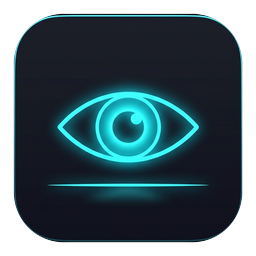

# myView ⚡
**Ultra-Fast, Lightweight Image & Vector Viewer for Windows**

<p align="center">
  
  <br><br>
  
  
  
  
  <br><br>
  <b>myView</b> - Σχεδιασμένο για αστραπιαία ταχύτητα, ελάχιστη κατανάλωση πόρων και υποστήριξη επαγγελματικών format.
</p>

---

## 📚 Αναλυτική Τεκμηρίωση (Documentation)

- 🏗️ **[Αρχιτεκτονική & Pipeline (Architecture)](docs/ARCHITECTURE.md)**: Ανάλυση του υβριδικού συστήματος αποκωδικοποίησης (WIC, LibRaw, SharpVectors), LRU cache και μαθηματικών zoom.
- 🎨 **[Υποστηριζόμενα Formats (Supported Formats)](docs/SUPPORTED_FORMATS.md)**: Πλήρης λίστα όλων των υποστηριζόμενων camera RAW, raster, Photoshop και διανυσματικών αρχείων.
- ⌨️ **[Συντομεύσεις Πληκτρολογίου & Ποντικιού (Shortcuts)](docs/KEYBOARD_SHORTCUTS.md)**: Πλήρης οδηγός χειρισμού και gestures.
- 📄 **[Άδεια Χρήσης (License)](LICENSE)**: Creative Commons Attribution-NonCommercial 4.0 (CC BY-NC 4.0).

---

## 🚀 Χαρακτηριστικά & Λειτουργίες (Features)

1. **Ασύλληπτη Ταχύτητα & Ελαφρύ Μέγεθος:**
   - Ταχύτατη αποκωδικοποίηση μέσω GPU Hardware Acceleration (DirectX/WIC) για standard εικόνες (~2-5ms).
   - Ασύγχρονο πολυνηματικό decoding (Task-based) που δεν μπλοκάρει ποτέ το UI.
   - **Background Pre-caching:** Αυτόματη προφόρτωση επόμενης και προηγούμενης εικόνας στο παρασκήνιο (LRU cache) ώστε η εναλλαγή με βελάκια να είναι απολύτως στιγμιαία (0ms latency).

2. **Υποστηριζόμενα Αρχεία (Supported Formats):**
   - **Standard Raster:** JPG, JPEG, PNG, BMP, GIF, WebP, TIFF, ICO.
   - **Vector / Inkscape:** SVG, SVGZ (άπειρο ζουμ χωρίς pixelation μέσω vector engine).
   - **Adobe Photoshop:** PSD, PSB (πλήρης υποστήριξη composite στρωμάτων).
   - **Camera RAW:** Πλήρης επεξεργασία αισθητήρα (Full RAW demosaicing) για CR2, CR3 (Canon), NEF, NRW (Nikon), ARW, SRF, SR2 (Sony), DNG (Adobe/Leica/Mobile), ORF (Olympus), RW2 (Panasonic), PEF, PTX (Pentax), RAF (Fuji), X3F (Sigma), SRW (Samsung).

3. **Πλοήγηση & Ταξινόμηση (Navigation & Sorting):**
   - **Βελάκι Δεξιά / Αριστερά (Right / Left Arrow):** Επόμενη / Προηγούμενη εικόνα.
   - **Home:** Πρώτη εικόνα του τρέχοντος φακέλου.
   - **End:** Τελευταία εικόνα του φακέλου.
   - **Ταξινόμηση (Sort):** Αλφαβητικά (A-Z, Z-A με natural numeric sorting: π.χ. `img2` πριν το `img10`), ανά Ημερομηνία τροποποίησης (Νεότερα/Παλαιότερα) και ανά Μέγεθος αρχείου. Πλήκτρο `S` ή κλικ στο badge ταξινόμησης.

4. **Έλεγχος Μεγέθυνσης & Προβολής (Pan & Zoom):**
   - **Ροδέλα Ποντικιού (Mouse Wheel):** Ομαλό Zoom In & Out εστιασμένο ακριβώς στη θέση του κέρσορα.
   - **Σύρσιμο (Click & Drag):** Ελεύθερη μετακίνηση (Pan) όταν η εικόνα είναι σε μεγέθυνση.
   - **Fit Screen (F ή 0):** Αυτόματη προσαρμογή στο παράθυρο με διατήρηση των αναλογιών.
   - **Native Size 100% 1:1 (1):** Προβολή σε πραγματικές διαστάσεις pixel.
   - **Double-click:** Εναλλαγή μεταξύ Fit και 100%.
   - **Περιστροφή & Αναστροφή:** Rotate 90° Clockwise (`R`), Counter-Clockwise (`L`), Flip Horizontal (`H`).

5. **Αναλυτικό Πάνελ EXIF & Metadata (`I`):**
   - Αναδιπλούμενο, ημιδιαφανές πλαϊνό πάνελ χωρίς διακοπή της προβολής.
   - **Camera & Lens:** Κατασκευαστής, μοντέλο μηχανής, φακός.
   - **Exposure Badges:** Ταχύτητα κλείστρου (Shutter), Διάφραγμα (f-number), Ευαισθησία (ISO), Εστιακό μήκος (Focal length), Αντιστάθμιση έκθεσης (Exposure Bias).
   - **Shooting Conditions:** Φλας, White Balance, Φωτομέτρηση (Metering).
   - **GPS Coordinates:** Γεωγραφικό πλάτος/μήκος με απευθείας κουμπί προβολής στο Google Maps.
   - **Αναζήτηση & Πλήρες Δέντρο:** Search box για άμεσο φιλτράρισμα όλων των raw tags.
   - **Αντιγραφή στο Clipboard:** Κουμπί για αντιγραφή όλων των στοιχείων με ένα κλικ.

6. **Μοντέρνο Minimalist Dark UI:**
   - Μέγιστη επιφάνεια προβολής της εικόνας.
   - Floating HUD μπάρα εργαλείων που εξαφανίζεται αυτόματα όταν το ποντίκι είναι αδρανές για 2.5 δευτερόλεπτα και επανέρχεται με την κίνηση.
   - Πλήρης υποστήριξη **Drag & Drop** (σύρετε οποιαδήποτε εικόνα ή φάκελο στο παράθυρο).
   - Υποστήριξη Command-line (π.χ. `myView.exe "C:\Photos\image.jpg"`).
   - Πλήρης οθόνη (**Fullscreen**, `F11`).

7. **Ενσωμάτωση στα Windows (Windows Integration):**
   - **Ορισμός ως Προεπιλογή (Default Viewer):** Με 1 κλικ μέσα από το παράθυρο «Περί» (`F1`), η εφαρμογή δηλώνεται στο μητρώο των Windows (`HKCU` - χωρίς απαίτηση δικαιωμάτων διαχειριστή) και ανοίγουν οι ρυθμίσεις προεπιλογών των Windows.
   - **Open With:** Αυτόματη εμφάνιση του myView στο δεξί κλικ «Άνοιγμα με...» για όλα τα υποστηριζόμενα αρχεία.

---

## ⌨️ Συντομεύσεις Πληκτρολογίου (Keyboard Shortcuts)

| Πλήκτρο | Ενέργεια |
| :--- | :--- |
| **`→` / `Space` / `Page Down`** | Επόμενη εικόνα (Next Image) |
| **`←` / `Backspace` / `Page Up`** | Προηγούμενη εικόνα (Previous Image) |
| **`Home`** | Πρώτη εικόνα φακέλου (First Image) |
| **`End`** | Τελευταία εικόνα φακέλου (Last Image) |
| **`+` / `=` / `Wheel Up`** | Zoom In (Μεγέθυνση) |
| **`-` / `Wheel Down`** | Zoom Out (Σμίκρυνση) |
| **`F` / `0`** | Προσαρμογή στην οθόνη (Fit to Screen) |
| **`1`** | Πραγματικό μέγεθος 100% (1:1 Native Size) |
| **`Διπλό Κλικ (Double Click)`** | Εναλλαγή μεταξύ Fit και 100% |
| **`R`** | Δεξιόστροφη περιστροφή 90° (Rotate Right) |
| **`L`** | Αριστερόστροφη περιστροφή 90° (Rotate Left) |
| **`H`** | Οριζόντια αναστροφή (Flip Horizontal) |
| **`S`** | Αλλαγή σειράς ταξινόμησης (Cycle Sort Mode) |
| **`I`** | Άνοιγμα / Κλείσιμο πάνελ EXIF (Toggle EXIF Sidebar) |
| **`F1`** | Άνοιγμα / Κλείσιμο παραθύρου Περί (About Dialog) |
| **`F11`** | Πλήρης οθόνη (Toggle Fullscreen) |
| **`Ctrl + O` / `O`** | Άνοιγμα αρχείου εικόνας (Open File) |
| **`Delete`** | Διαγραφή τρέχουσας εικόνας (με επιβεβαίωση) |
| **`Esc`** | Κλείσιμο διαλόγου Περί, πάνελ EXIF ή έξοδος από Fullscreen |

---

## 👨‍🏫 Περί & Δημιουργός (About & Creator)

<p align="center">
  
  <br>
  <b>Λέων Προκόπης</b> (Καθηγητής Πληροφορικής)
  <br>
  🌐 <a href="https://plarg.gr"><b>plarg.gr</b></a> — Εφαρμογές, εργαλεία &amp; σημειώσεις πληροφορικής
</p>

### ⚖️ Άδεια Χρήσης (License)

Το **myView** διατίθεται υπό την άδεια:  
**[Creative Commons Αναφορά Δημιουργού - Μη Εμπορική Χρήση 4.0 Διεθνές (CC BY-NC 4.0)](https://creativecommons.org/licenses/by-nc/4.0/deed.el)**

> **Δωρεάν χρήση και διανομή για εκπαιδευτικούς σκοπούς, με αναφορά στον δημιουργό (Λέων Προκόπης) και χωρίς εμπορική χρήση.**
>
> Είστε ελεύθεροι να μοιραστείτε, να αντιγράψετε και να τροποποιήσετε το έργο υπό τον όρο της αναφοράς του δημιουργού ([plarg.gr](https://plarg.gr)) και αποκλειστικά για μη εμπορικούς σκοπούς.

---

## 📦 Λήψη & Εγκατάσταση (Installation & Download)

Μπορείτε να κατεβάσετε την τελευταία έκδοση από τα **[GitHub Releases](https://github.com/pliroforikos/myViewer/releases)**:

| Αρχείο | Τύπος | Περιγραφή |
| :--- | :--- | :--- |
| **`myView-v1.0.2-setup.exe`** | **Windows Setup Installer** *(Προτεινόμενο)* | Πλήρης εγκαταστάτης (Inno Setup) με οδηγό βήμα-προς-βήμα, συντομεύσεις, απεγκατάσταση και αυτόματη δήλωση προεπιλογής. Δεν απαιτείται .NET. |
| **`myView-v1.0.2-lightweight-setup.exe`** | **Lightweight Setup** (~11 MB) | Ελαφρύς εγκαταστάτης για συστήματα που διαθέτουν ήδη εγκατεστημένο το .NET 10 Runtime. |
| **`myView-v1.0.2-standalone-win-x64.zip`** | **Portable Zip (Standalone)** | Φορητή έκδοση σε zip — απλώς αποσυμπιέστε και τρέξτε το `myView.exe` χωρίς καμία εγκατάσταση. |
| **`myView-v1.0.2-windows-x64.zip`** | **Portable Zip (Lightweight)** | Φορητή έκδοση (~13 MB) για χρήστες με .NET 10. |

---

## 🛠️ Εκτέλεση & Μεταγλώττιση (Build & Run)

Απαιτήσεις: [.NET 10 SDK](https://dotnet.microsoft.com/)

```powershell
# Μεταγλώττιση (Build)
dotnet build

# Εκτέλεση αυτοματοποιημένων δοκιμών (Automated Self-Test)
dotnet run -- --test

# Εκτέλεση εφαρμογής (Run Application)
dotnet run

# Δημιουργία Standalone Release Build
dotnet publish -c Release -r win-x64 --self-contained true -p:PublishSingleFile=true -o dist/myView-standalone-win-x64

# Δημιουργία Setup Installer (απαιτεί Inno Setup 6)
iscc installer\myView_Standalone_Setup.iss
```
